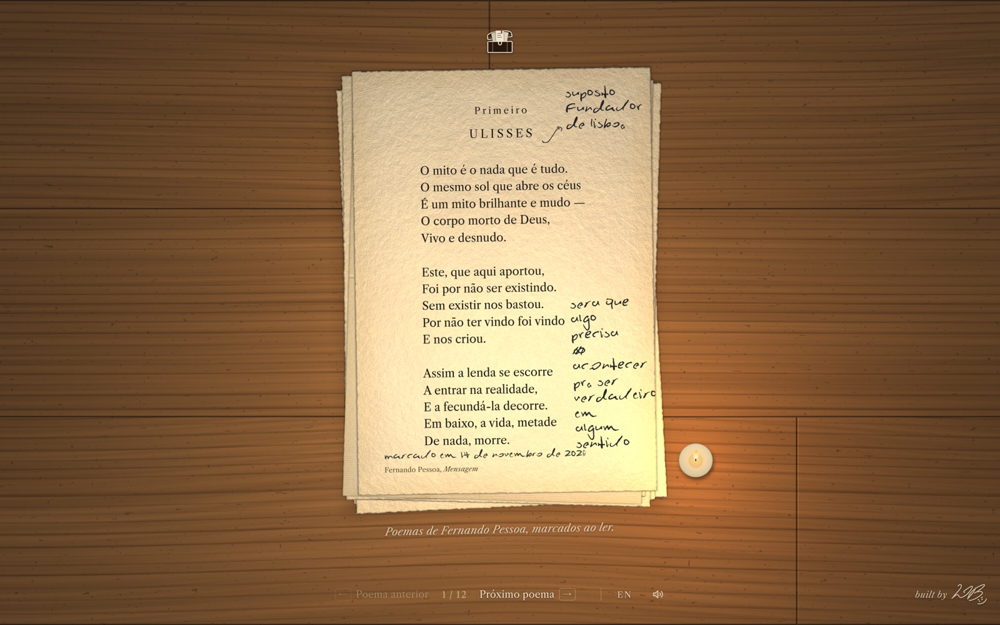
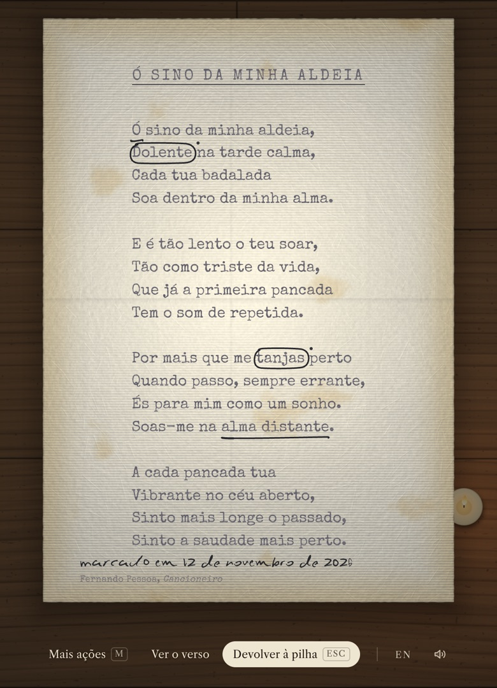
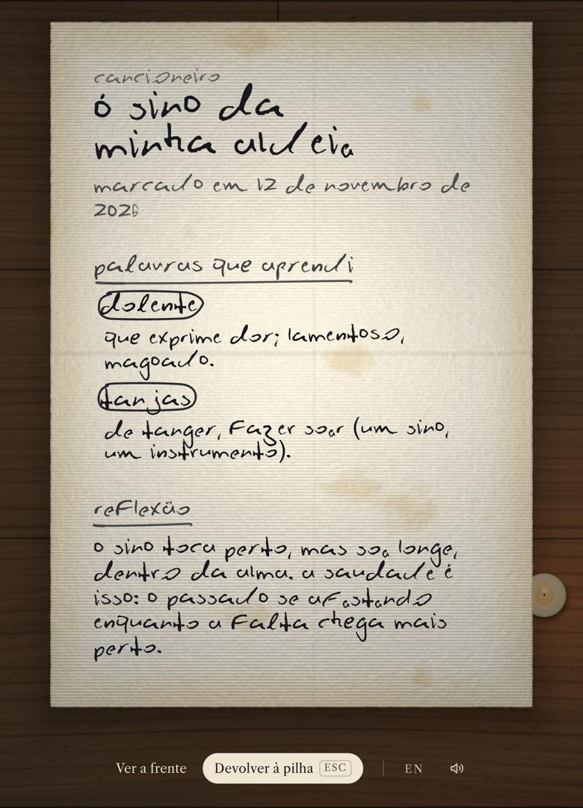
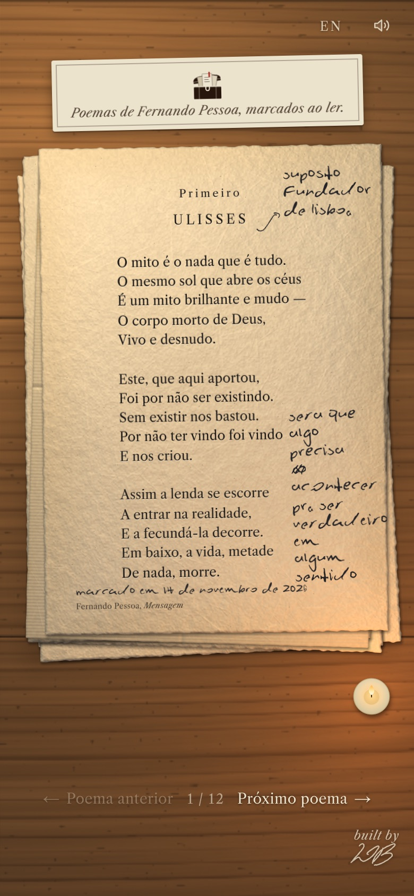

<div align="center">

# arca

fernando pessoa's poems, on loose paper, under a lamp

[arcadepessoa.com](https://arcadepessoa.com)

<br>



</div>

<br>

when fernando pessoa died, a trunk was found with about 25,000 loose pages inside. in portuguese, a trunk is an *arca*.

this is a small one of my own: the poems i marked while reading *mensagem* and the *cancioneiro*, with my pen marks and notes in my own handwriting.

<p align="center">
  
  
  
</p>

<br>

## what you can do

- slide the top sheet away to see the next one
- pick a sheet up and read it under the lamp
- turn it over: the date, the words i learned, a short note
- press a marked word to open its note
- select lines to hear them read aloud, translate them into english, look a word up, or share them
- move the light with your mouse, your finger, or by tilting your phone
- blow out the candle, or light it again
- hear the paper as you move it, or switch the sound off

every gesture also has a button and a key (arrows, `esc`, `m` for more), so it all works without dragging and with a screen reader. reduced motion is respected.

the interface is in portuguese and english (`/en`). the poems stay in portuguese.

every reading position has its own link: `/poema/o-mostrengo/2/verso`, or `#v3-5` for lines 3 to 5.

<br>

## the paper

| book | paper |
| --- | --- |
| *mensagem* | cream card, ink pressed into the page |
| *cancioneiro* | thin typewriter paper, uneven ink |

the words are always real html text. only the paper under them is drawn, with webgl.

<br>

## run it

```bash
pnpm install
```

```bash
pnpm dev
```

translating lines needs `AI_GATEWAY_API_KEY` in `.env.local` (vercel ai gateway). without it, everything else works.

<br>

## add a poem

make a file in `content/poems/`. its name becomes the link: `isto.mdx` → `/poema/isto`.

```mdx
---
title: Isto
book: cancioneiro        # mensagem | cancioneiro
markedAt: "2026-09-28"   # newest goes on top of the pile
source: http://arquivopessoa.net/textos/…
words:
  - word: enleio
    meaning: …
reflection: …
---

one stanza per paragraph,
one line of verse per line.

---

three dashes start a new sheet.
long poems are held by a paper clip.
```

optional fields: `numeral` (the poem's number in its book), `paper` (`carta` | `maquina`, to override the book's), `titleNote` (a note beside the title, with an arrow), and `facsimile` (`{ src, source, caption? }`, a scan of pessoa's own page on the back).

my marks go in the poem too:

```mdx
Soas-me na <Mark>alma distante</Mark>.
Por mais que me <Mark como="circulo" note="de tanger: fazer soar">tanjas</Mark> perto
Sem existir nos bastou.<Margem largura={5}>será que algo precisa <Risco /> acontecer…</Margem>
```

| | |
| --- | --- |
| `<Mark>` | underlines. `como="circulo"` circles, `note="…"` adds a note that opens on press |
| `<Margem>` | a handwritten note beside the line. `lado="baixo"` puts it under the poem; `x`, `y`, `largura`, `inclina` place it |
| `<Risco />` | a scribbled-out word |

take the text from [arquivo pessoa](http://arquivopessoa.net) and check it. anything not written by me is marked `RASCUNHO` in the frontmatter until i review it.

after adding a poem, rerun the link previews (below).

<br>

## scripts

| | |
| --- | --- |
| `pnpm og` | records the link previews (a short video and a still per page) from the real desk. run against `pnpm build && pnpm start --port 3211` |
| `pnpm papel` | bakes the paper and wood shown before webgl draws. run against `pnpm dev` after changing the shaders |
| `scripts/letra/` | builds my handwriting font from photos of my notes ([how](scripts/letra/README.md)) |

<br>

## made with

next.js · react · typescript · webgl · mdx

poem texts from [arquivo pessoa](http://arquivopessoa.net). for agents: [`/llms.txt`](https://arcadepessoa.com/llms.txt).
